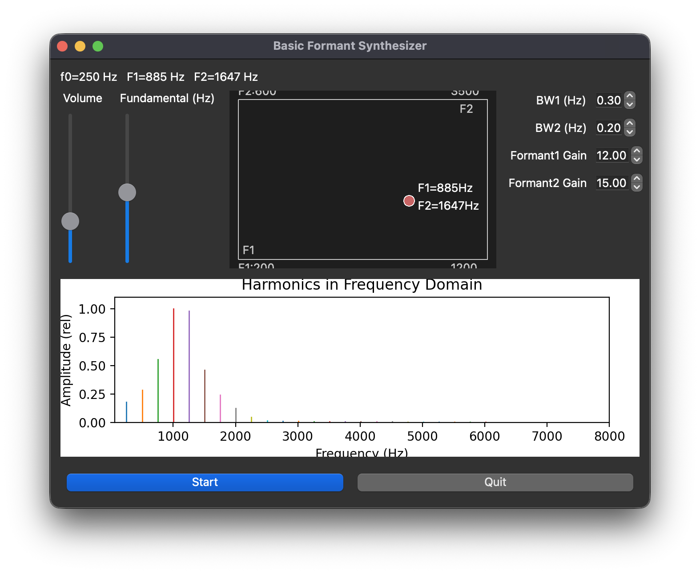

# Formant Synthesizer

A real-time vowel synthesizer built with additive synthesis. It generates a harmonic source and shapes it with two adjustable formants, so changing their frequencies changes the perceived vowel quality.



## Run

Requires Python 3 and an available audio-output device.

```bash
python -m pip install numpy numba sounddevice PyQt5 matplotlib
python main.py
```

Click **Start** to enable sound. Drag the dot in the formant pad to set the frequencies of the first (F1) and second (F2) formants.

Use the other controls to adjust volume, fundamental frequency, formant bandwidths, and formant gains. The plot in the bottom shows the current harmonic amplitude spectrum.

## Implementation

The synthesizer combines 24 sine-wave harmonics in real time. Two Gaussian spectral boosts centered at F1 and F2 model vocal-tract formants; parameter transitions are smoothed to reduce clicks.
